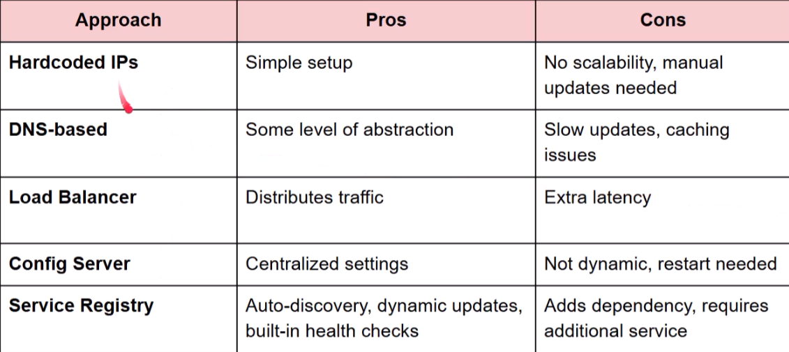
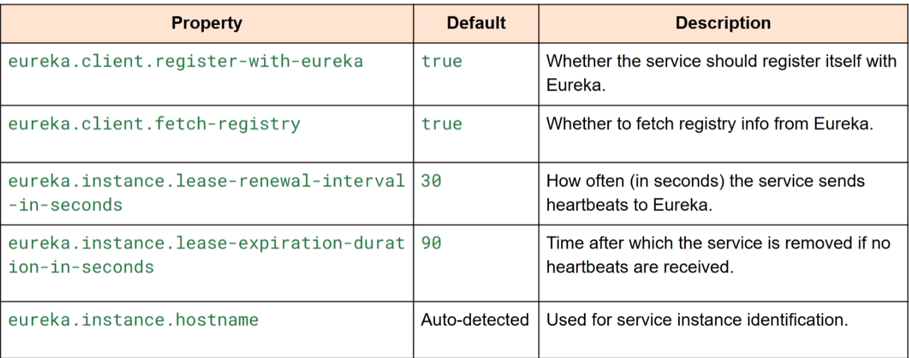
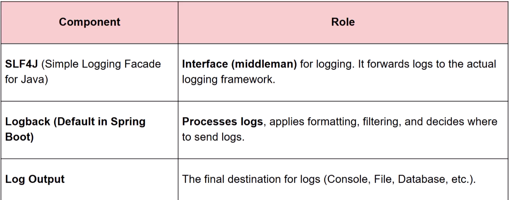
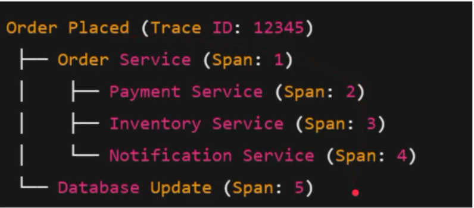

# E-commerce microservices

Backend e-commerce découpé en microservices Spring Boot : catalogue produits, utilisateurs, panier et commandes, avec configuration centralisée, découverte de services, logs, métriques et traces distribuées.

## Architecture

```text
                 ┌──────────────┐      ┌──────────────┐
                 │ config-server│      │    eureka    │
                 │    :8888     │      │    :8761     │
                 └──────┬───────┘      └──────┬───────┘
          config (au démarrage)        enregistrement / découverte
        ┌───────────────┼─────────────────────┼───────────────┐
        ▼               ▼                     ▼               ▼
 ┌─────────────┐ ┌─────────────┐       ┌─────────────┐
 │ product     │ │ user        │◄──────│ order       │
 │ :8081       │ │ :8082       │  HTTP │ :8083       │
 │ PostgreSQL  │ │ MongoDB     │       │ PostgreSQL  │
 └─────────────┘ └─────────────┘       └──────┬──────┘
        ▲                                     │ HTTP (load-balancé via Eureka)
        └─────────────────────────────────────┘
```

| Module | Nom applicatif | Port | Stockage | API |
|---|---|---|---|---|
| `config-server/` | `config-server` | 8888 | fichiers YAML (`config/`) | — |
| `eureka/` | `eureka` | 8761 | — | tableau de bord Eureka |
| `gateway/` | `gateway` | 8080 | — | point d'entrée : `/api/v1/**` routé vers les services (en cours) |
| `product/` | `product-service` | 8081 | PostgreSQL (JPA) | `/api/v1/products` |
| `user/` | `user-service` | 8082 | MongoDB | `/api/v1/users` |
| `order/` | `order-service` | 8083 | PostgreSQL (JPA + Flyway, schéma `order_service`) | `/api/v1/cart`, `/api/v1/orders` |

Chaque module est un **projet Maven indépendant** avec son propre `mvnw` (pas de POM parent).

**Stack** : Java 21, Spring Boot 4.1.2, Spring Cloud 2025.1.4 (Config, Bus/RabbitMQ, Netflix Eureka, LoadBalancer), Spring Security, Spring Data JPA / MongoDB, Flyway, springdoc-openapi, Micrometer (Prometheus + Tracing Brave/Zipkin), Lombok, Jackson 3, JUnit 5, Mockito, Testcontainers.

## Démarrage

### Prérequis
- JDK 21, Docker (obligatoire aussi pour les tests : Testcontainers).
- Une instance MongoDB sur `localhost:27017` pour `user-service` (le service MongoDB du `docker-compose.yaml` est commenté).

### Variables d'environnement

| Service | Variables |
|---|---|
| order | `DB_USERNAME`, `DB_PASSWORD` |
| product | `POSTGRES_URL`, `POSTGRES_USERNAME`, `POSTGRES_PASSWORD` |
| user | `MONGODB_URI` (défaut : `mongodb://localhost:27017/user`) |

### Ordre de lancement

```bash
docker compose up -d                 # racine : PostgreSQL 16, pgAdmin, RabbitMQ
(cd loki && docker compose up -d)    # observabilité : Loki, Alloy, Prometheus, Grafana, Zipkin

cd config-server && ./mvnw spring-boot:run   # 1. configuration
cd eureka        && ./mvnw spring-boot:run   # 2. registre de services
cd product       && ./mvnw spring-boot:run   # 3. puis les services, dans n'importe quel ordre
cd user          && ./mvnw spring-boot:run
cd order         && ./mvnw spring-boot:run
cd gateway       && ./mvnw spring-boot:run   # 4. facultatif : point d'entrée sur :8080
```

Sous Windows PowerShell : `.\mvnw.cmd`. Lancer les services depuis la racine du dépôt si l'on veut que leurs logs arrivent dans `logs/` (lu par Alloy).

### Configuration
- Les services ne contiennent que leur nom et `spring.config.import: optional:configserver:http://localhost:8888`. **La vraie configuration est dans `config-server/src/main/resources/config/<nom>-service.yml`.**
- Le config-server tourne en profil `native` sur un chemin absolu : une modification des YAML est servie sans redémarrer le config-server (les services, eux, doivent être redémarrés ou rafraîchis via Spring Cloud Bus).
- `order-service` n'a besoin d'aucune préparation de base : Flyway crée le schéma `order_service` et applique `order/src/main/resources/db/migration` (`V1` tables panier/commandes, `V2` `user_id` en `varchar`).

## API

Swagger UI sur chaque service : `http://localhost:<port>/swagger-ui.html` (spec : `/v3/api-docs`).

### product-service (`/api/v1/products`)
| Méthode | Chemin | Description |
|---|---|---|
| GET | `/` | Produits actifs |
| POST | `/` | Créer un produit (`stock` à 0 par défaut) |
| GET | `/{id}` | Produit actif par id (404 si inexistant ou inactif) |
| PUT | `/{id}` | Remplacer un produit |
| DELETE | `/{id}` | Supprimer (suppression physique) |
| GET | `/search?name=` | Recherche par nom (actifs, en stock) ; 404 si aucun résultat |

### user-service (`/api/v1/users`)
| Méthode | Chemin | Description |
|---|---|---|
| GET | `/` | Liste des utilisateurs |
| POST | `/` | Créer un utilisateur (email unique) |
| GET | `/{id}` | Utilisateur par id |
| PUT | `/{id}` | Remplacer un utilisateur (adresse comprise) |

### order-service (`/api/v1/cart`, `/api/v1/orders`)
L'utilisateur est identifié par l'en-tête **`X-User-ID`** (id MongoDB de user-service).

| Méthode | Chemin | Description |
|---|---|---|
| POST | `/api/v1/cart` | Ajouter un produit au panier (vérifie produit actif, stock, utilisateur) |
| DELETE | `/api/v1/cart/items/{productId}` | Retirer une ligne du panier |
| GET | `/api/v1/cart/items` | Contenu du panier |
| POST | `/api/v1/orders` | Passer commande à partir du panier, puis le vider |

Les prix stockés sont **unitaires** ; les totaux sont calculés `prix × quantité`. Produit ou utilisateur introuvable → 404.

## Communication entre services avant Eureka


## Communication entre services avec Eureka
- `order` appelle `product` et `user` via des **interfaces HTTP Spring** (`@HttpExchange`) construites sur un `RestClient` **`@LoadBalanced`** : les URL `http://PRODUCT-SERVICE` / `http://USER-SERVICE` sont résolues par Eureka.
- Un builder `RestClient` `@Primary` non load-balancé est déclaré à part : sans lui le client Eureka utiliserait le builder load-balancé et ne pourrait pas s'enregistrer.
- Un 404 distant (`HttpClientErrorException.NotFound`) est converti en « introuvable » ; les autres erreurs distantes remontent en 500.
- `@LoadBalanced` ne répartit que les appels **sortants** d'order.
- Pas de timeout, retry ni circuit breaker pour l'instant.



## API Gateway (Spring Cloud Gateway)

### Pourquoi une API gateway ?
Sans gateway, chaque client doit gérer seul plusieurs problèmes :
- **connaître l'URL de chaque microservice** (hôte, port, nombre d'instances), qui change à chaque déploiement : c'est le rôle de la découverte de services (Eureka) ;
- **gérer la sécurité et l'authentification** auprès de chaque service ;
- **maîtriser les URL exposées** : sans gateway, tous les endpoints de tous les services sont publics ;
- **centraliser les appels d'API** vers des services qui ont chacun leur propre URL.

### C'est quoi ?
Un **point d'entrée unique** placé devant les microservices. Le client ne connaît que la gateway, pas l'architecture sous-jacente. On peut la voir comme un **reverse proxy** qui route chaque appel vers le bon service.

**Avantages**
- **Encapsulation du système** : on peut ajouter, supprimer ou modifier des services sans impacter les clients.
- **Préoccupations transverses gérées à un seul endroit** : sécurité, load balancing, rate limiting, analytics.
- **Authentification des requêtes entrantes** : seules les requêtes valides atteignent les services.
- **Agrégation** des réponses de plusieurs microservices.

**Fonctionnalités** et état dans ce projet :

| Fonctionnalité | Dans ce projet |
|---|---|
| Routage des requêtes | ✅ routes par chemin vers product, user, order et Eureka |
| Load balancing | ✅ `lb://<SERVICE>` : instances résolues via Eureka |
| Transformation requête/réponse | ✅ réécriture de chemin (`RewritePath`, `SetPath`) |
| Traces distribuées | ✅ via Zipkin, échantillonnage à 100 % |
| Authentification / autorisation | ⏳ `JwtAuthFilter` écrit mais désactivé, validation du JWT à faire |
| Rate limiting | ❌ (`RequestRateLimiter` de Spring Cloud Gateway, qui nécessite Redis) |
| Agrégation de données de plusieurs services | ❌ |

Les **filtres** interceptent les requêtes entrantes et les réponses :
- un `GlobalFilter` s'applique à toutes les routes (exemple : `LoggingFilter`) ;
- un `WebFilter` s'applique à toutes les requêtes reçues par l'application (exemple : `JwtAuthFilter`) ;
- les filtres de route ne s'appliquent qu'à leur route (`RewritePath`, `SetPath`…).

`LoggingFilter` et `JwtAuthFilter` sont dans `gateway/filter/`, désactivés (`@Component` commenté).

### Mise en place dans ce projet
- Module `gateway/` : Spring Cloud Gateway **server WebFlux** (réactif, Netty) sur le port **8080**. Spring Boot 4.2.0, contre 4.1.2 pour les autres modules.
- **Configuration dans le config-server** (`config-server/src/main/resources/config/gateway.yml`), plus pratique : le `application.yaml` local ne contient que le nom et `spring.config.import`. Pour voir la configuration servie : http://localhost:8888/gateway/default.
- La gateway s'enregistre dans **Eureka** comme les autres services.
- **Eureka accessible sur 8080** grâce à deux routes vers `http://localhost:8761` :
  - `/eureka/main` (avec `SetPath=/`) pour le tableau de bord : http://localhost:8080/eureka/main ;
  - `/eureka/**` pour ses ressources statiques (CSS, JS).
- **Routes exposées** : chemins publics courts, réécrits vers l'API réelle des services.

  | Gateway (`http://localhost:8080`) | Service (via Eureka) | Chemin transmis |
  |---|---|---|
  | `/products/**` | `lb://PRODUCT-SERVICE` | `/api/v1/products/**` |
  | `/users/**` | `lb://USER-SERVICE` | `/api/v1/users/**` |
  | `/orders/**`, `/cart/**` | `lb://ORDER-SERVICE` | `/api/v1/orders/**`, `/api/v1/cart/**` |
  | `/eureka/main` | `http://localhost:8761` | `/` |

  Exemple : `GET http://localhost:8080/products/12` → `GET /api/v1/products/12` sur une instance de product-service. Les chemins `/api/v1/...` ne sont pas routés par la gateway.
- **Traces** : la gateway est échantillonnée à 100 %, car sa décision d'échantillonnage est propagée aux services. La propagation de la trace vers les services nécessite `spring-boot-starter-actuator` dans la gateway.
- **Tests** : `GatewayConfigTest` charge les routes depuis le `gateway.yml` du config-server (sans config-server démarré) et vérifie, pour chaque chemin public, la route choisie et le chemin transmis.

### Routes en YAML ou en Java
Les deux syntaxes sont équivalentes, mais il ne faut **en garder qu'une active** :
- **YAML** (`spring.cloud.gateway.server.webflux.routes`) : **utilisé ici**. La configuration est centralisée dans le config-server et modifiable sans recompiler.
- **Java** (bean `RouteLocator` construit avec `RouteLocatorBuilder`) : typé et plus souple, par exemple pour des prédicats ou filtres sur mesure. Version conservée dans `gateway/config/GatewayConfig`, désactivée (`@Configuration` et `@Bean` commentés).

### Filtre RewritePath
Il permet d'exposer un chemin différent du vrai endpoint du service, par exemple `/products` au lieu de `/api/v1/products`.

En YAML (version active, `gateway.yml`) :
```yaml
spring:
  cloud:
    gateway:
      server:
        webflux:
          routes:
            - id: user-service
              uri: lb://USER-SERVICE
              predicates:
                - Path=/users/**
              filters:
                - "RewritePath=/users(?<segment>/?.*), /api/v1/users${segment}"
```

En Java (`GatewayConfig`, désactivé) :
```java
builder.routes()
        .route("product-service", r -> r.path("/products/**")
                .filters(f -> f.rewritePath("/products(?<segment>/?.*)", "/api/v1/products${segment}"))
                .uri("lb://PRODUCT-SERVICE"))
        .build();
```

Points d'attention :
- **Le prédicat `Path` porte sur le chemin public** (`/products/**`), pas sur le chemin du service : une requête sur `/products` ne correspondrait jamais à `Path=/api/v1/products/**`.
- **Le `/` doit être dans le groupe capturé** : `/products(?<segment>/?.*)`. Avec `/products/(?<segment>/?.*)` :
  - `/products` n'est pas réécrit et arrive tel quel au service. Il répond **403**, car un chemin inconnu part sur `/error`, qui n'est pas en `permitAll` ;
  - `/products/12` devient `/api/v1/products12`.
- En YAML, la valeur du filtre est entre guillemets, avec la regex et le remplacement séparés par une virgule.

### Design patterns d'API gateway
- **Single Entry Point** (point d'entrée unique) : une seule gateway pour tous les clients, qui route vers les services. **C'est le pattern utilisé ici.**
- **BFF (Backend for Frontend)** : une gateway par type de client (web, mobile, partenaires…), car leurs besoins ne sont pas les mêmes. Chaque réponse est optimisée pour le client qui la reçoit : champs utiles, taille, format.
- **Aggregation Gateway** : la gateway appelle plusieurs microservices et agrège leurs réponses en un seul message renvoyé au front. Exemple : une page commande avec le détail de l'utilisateur et des produits. Cela évite au client plusieurs allers-retours.
- **Gateway Offloading** : on déporte dans la gateway les préoccupations transverses (authentification, TLS, rate limiting, logs, traces) pour que les services n'aient pas à les implémenter.

## Observabilité (`loki/`)

| Outil | URL | Rôle |
|---|---|---|
| Grafana | http://localhost:3000 | Tableaux de bord (accès anonyme admin) |
| Prometheus | http://localhost:9090 | Métriques (`/actuator/prometheus` des 3 services, toutes les 3 s) |
| Loki (gateway) | http://localhost:3100 | Logs, stockage `filesystem` (volume `loki-data`) |
| Alloy | http://localhost:12345 | Collecte des logs (fichiers `logs/*.log` + conteneurs Docker) → Loki (tenant `tenant1`) |
| Zipkin | http://localhost:9411 | Traces distribuées |

- **Logs** : chaque service écrit `logs/<nom>-service.log` avec rotation par taille et par date (le motif d'archive doit contenir `%i`).

- **Grafana** : datasources Loki et Prometheus provisionnées depuis `loki/datasources/datasources.yml` (Prometheus a l'uid fixe `prometheus`). Les dashboards sont importés depuis l'interface et conservés dans le volume `grafana-data`. Pour un dashboard grafana.com (ex. 4701 « JVM (Micrometer) »), remplacer `${DS_PROMETHEUS}` par `prometheus` dans le JSON Model si l'import ne demande pas la datasource.
- **Traces** : échantillonnage à 100 % dans les quatre applications, envoi vers Zipkin. La gateway doit elle aussi être à 100 % : sa décision d'échantillonnage est propagée aux services en aval (avec le défaut de 10 %, 9 requêtes sur 10 passées par la gateway ne seraient tracées nulle part). Dans Zipkin, filtrer par service ou par nom de span.
- **Bruit exclu du tracing** (`config/ObservationConfig` dans chaque application) :
  - les requêtes `/actuator/**` (Prometheus les appelle toutes les 3 s) ;
  - les observations Spring Security sans vraie requête parente (sinon chaque appel actuator exclu laisserait deux traces orphelines « security filterchain ») ;
  - les appels du client Eureka au serveur (`/eureka/**` : heartbeat et récupération du registre toutes les 30 s), y compris depuis la gateway.
- le tracing permet d'afficher chaque requete d'un workflow dans des microservices pour savoir quel service fait quoi : span id execution du microservice - trace id execution de toute la requete
  
- Les appels order → product/user sont dans la même trace que la requête d'origine : le builder `RestClient` load-balancé (`order/config/ObservatoryConfiguration`) reçoit l'`ObservationRegistry`, chaque appel devient un span client enfant et les en-têtes de trace sont propagés. Exemple pour `POST /api/v1/orders` : span serveur order → span client `GET /api/v1/users/{id}` → span serveur user-service.

## Tests

```bash
cd <module> && ./mvnw test                     # unitaires + intégration (Docker requis)
./mvnw -Dtest=CartServiceTest test             # une classe
```

- Unitaires (Mockito), tranches web (`@WebMvcTest`), intégration/E2E (`@SpringBootTest` + Testcontainers PostgreSQL / MongoDB, profil `test`, sans config-server).
- Dans `order`, `ProductClient` et `UserClient` sont mockés : product-service et user-service n'ont pas besoin de tourner.
- Couverture mesurée avec JaCoCo à **100 % des lignes et des branches** sur order, product et user (plugin non déclaré dans les POM) :
  ```bash
  ./mvnw clean org.jacoco:jacoco-maven-plugin:0.8.12:prepare-agent test org.jacoco:jacoco-maven-plugin:0.8.12:report
  # rapport : target/site/jacoco/index.html
  ```

## Historique du projet
1. **Socle** : monorepo de microservices product / user / order, configuration centralisée avec Spring Cloud Config (+ Bus RabbitMQ).
2. **Revue de code** et corrections.
3. **Documentation d'API** avec springdoc (Swagger UI) et **migrations Flyway** pour order (schéma `order_service`, `ddl-auto: validate`).
4. **Découverte de services Eureka** et communication inter-services : order appelle product et user via `RestClient` load-balancé ; identifiant utilisateur passé en `String` (migration `V2`) ; gestion des 404 distants ; prix unitaires.
5. **Couverture de tests à 100 %** (lignes et branches) sur les trois services.
6. **Observabilité** : Loki + Alloy (stockage passé de MinIO au filesystem), Prometheus + Grafana (datasources provisionnées, uid fixe), correction de la rotation des logs (`%i`).
7. **Traces distribuées** avec Micrometer Tracing + Zipkin, endpoints actuator exclus du tracing.
8. **API gateway** (Spring Cloud Gateway, en cours) et **nettoyage des traces** : gateway échantillonnée à 100 %, spans Spring Security orphelins et appels Eureka exclus.

## À venir / points ouverts
- API gateway : authentification JWT (`JwtAuthFilter` présent mais désactivé, validation du token à écrire).
- Sécurité : les endpoints API et actuator (dont `shutdown`) sont en `permitAll`.
- Résilience des appels inter-services (timeouts, retry, circuit breaker).
- Le contrôle de stock à l'ajout au panier ne tient pas compte de la quantité déjà dans le panier.
